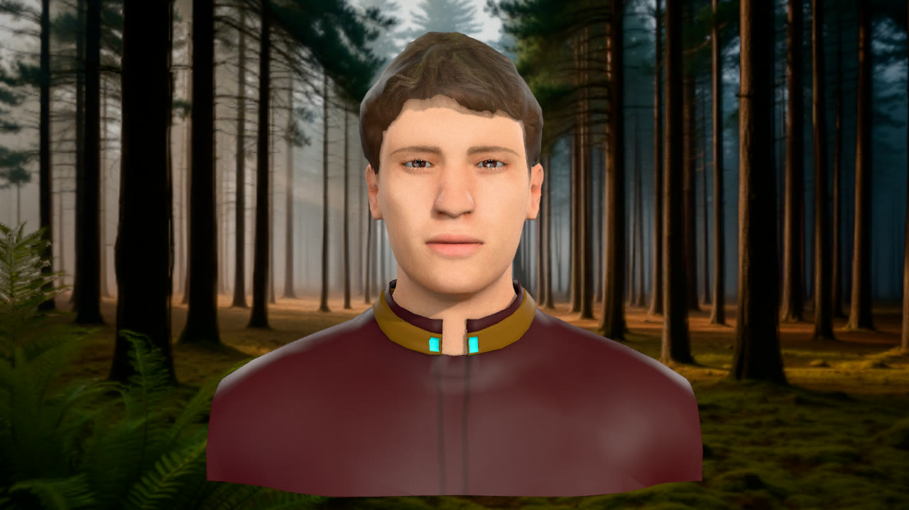
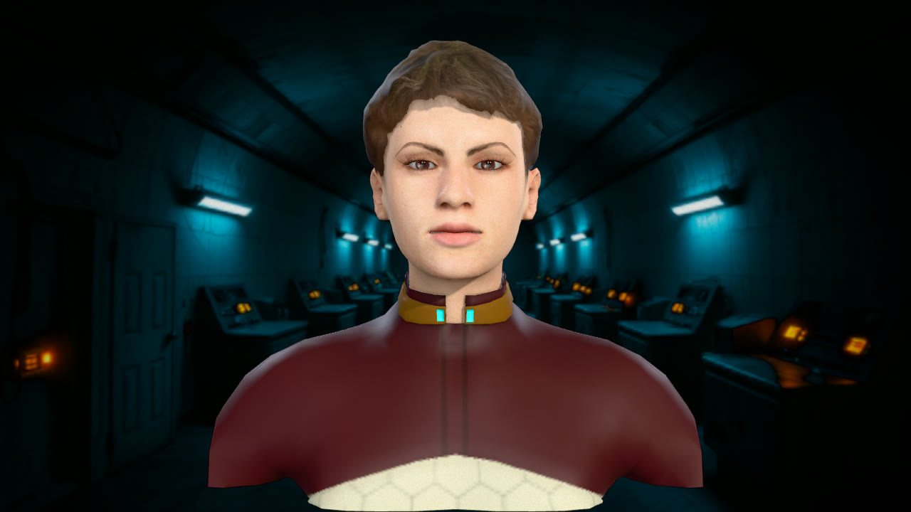

<h1>
  <picture>
    <source media="(prefers-color-scheme: dark)" srcset="https://raw.githubusercontent.com/smk762/argus-cortex/dev/brand/packages/mask/argus-mask-lockup-dark.svg">
    
  </picture>
</h1>

<!-- Live demo: https://mask.dragonhound.dev -->

A talking face for the Argus suite. Audio goes in; a stream of facial animation frames comes out; a browser page renders a rigged head from those frames, in step with the audio, on any screen on the LAN.

**Demo:** [mask.dragonhound.dev](https://mask.dragonhound.dev), a face you can watch talk (see [Hosted demo](#hosted-demo)).

Part of the [Argus suite](https://github.com/smk762?tab=repositories&q=argus). Mask sits off the main line, like argus-darkroom and argus-atlas. The design and build plan are in [spec.md](https://github.com/smk762/argus-mask/blob/main/spec.md).

```
audio source ──▶ argus-mask :8109 ──▶ viewer (browser, any LAN device)
(file, agent,     drive + sync         flat panel │ Looking Glass HLD
 TTS output)          │
                      ▼
               Audio2Face server (external, by URL)
```

## Status

Built and tested: the engine, both drivers, faces, the server, the viewer's `flat` and `hld` tiers, the CLI, and the Audio2Face server in [a2f/](https://github.com/smk762/argus-mask/blob/main/a2f/README.md).

Not built yet: the Looking Glass Go tier (0.2), and faces built from argus-curator output (0.3).

Not yet seen by a person: the stock head speaking on a real screen with sound. Its mouth was tuned from still frames of real Audio2Face output.

## Two ways to a face

**A mesh head**, built in the [face editor](#face-editor) (MakeHuman and MPFB in headless Blender), or one of the stock heads. It is a rigged `.glb` driven by the 52 ARKit shapes, and it can be cleared to show anywhere. Here are the two stock heads in front of backdrops (plates) generated through [argus-darkroom](https://github.com/smk762/argus-darkroom):

| `stock-01`, Highland pine forest | `stock-02`, underground bunker |
|---|---|
|  |  |

Each backdrop is one command, then any screen shows it as `?scene=<name>`, or as the face's own backdrop chosen on Saved faces ([docs/backgrounds.md](https://github.com/smk762/argus-mask/blob/main/docs/backgrounds.md)):

```bash
argus-mask plate generate assets/backgrounds/highland-forest --title "Highland pine forest" \
  --prompt "an old Caledonian pine forest in the Scottish Highlands, ferns in the foreground at the edges, misty morning light, a calm open clearing in the middle" \
  --drift 0.6 --sway 0.4 --dapple 0.35
```

**A photoreal splat head**, made from one portrait. Prefer the [guided head builder](#guided-head-builder) (`/guided.html` on the editor): portrait and provenance in, checks, a LAM build, evals, pick, scene and save. By hand, a synthetic portrait comes from darkroom ([docs/synthetic-faces.md](https://github.com/smk762/argus-mask/blob/main/docs/synthetic-faces.md): frontal, neutral, even light, hair over the temples), then `lam/` ([Splat heads](#splat-heads)). Mask drives the head like a mesh, in front of the same backdrops. A splat face over a backdrop is framed head and shoulders, since LAM's heads fade out below the collarbone. Two characters made this way:

- **Callum MacRae**, a Highland man of about 25, red-bearded, with optional blue woad: SDXL photoreal portrait, LAM head, Highland forest backdrop.
- **Nadia Volkova**, a blonde operative of about 25 in a black tactical jacket: SDXL photoreal portrait, LAM head, bunker backdrop.

A splat head made by `lam/` (FLAME 2023 Open, and our own FLAME code and tracker front end) from a cleared portrait can be cleared, as `splat-01` on the hosted demo is; LAM's weights are CC BY-NC 4.0, so it is credited and never commercial. One made with LAM's own pipeline (FLAME's academic model) stays `personal`. See [Personal and cleared](#personal-and-cleared).

## Quick start

```bash
make install
make head        # downloads the stock head into assets/stock-01 (10 MB, CC0)
uv run argus-mask serve --assets-dir assets
```

Open `http://127.0.0.1:8109/`, click once to allow sound, then from another terminal:

```bash
uv run argus-mask push hello.wav --face stock-01
```

That uses the `energy` driver, which moves the mouth from loudness and nothing more. For real lip sync, run the Audio2Face server (an NVIDIA GPU with about 1 GB of VRAM to spare) and point mask at it:

```bash
docker build -t argus-mask-a2f a2f/      # once; see a2f/README.md for what it needs
docker run -d --name a2f --gpus all -p 127.0.0.1:8110:8110 -v a2f-data:/data argus-mask-a2f
ARGUS_MASK_DRIVER=a2f ARGUS_MASK_A2F_URL=http://127.0.0.1:8110 uv run argus-mask serve --assets-dir assets
```

Or both in containers: `docker compose --profile a2f up --build`, with `DRIVER=a2f` and `A2F_URL=http://a2f:8110` in `.env`.

## Commands

| Command | What it does |
|---|---|
| `argus-mask inspect <face>` | Checks a face directory or a `.glb`: which of the 52 ARKit shapes it has, triangles, texture sizes. `--write-manifest` writes `manifest.json` beside a `.glb` or a splat `.zip`; it needs `--source`, and `--license` too for any `--kind` but the default `personal` (`consented` also needs `--subject` and `--release-sha256`; a generated face may add `--generator`, `--generator-sha256`, `--generator-seed` and `--prompt`). It and takes `--distance`, `--height` and `--fov` for the camera framing. |
| `argus-mask drive <audio.wav> --out take.ndjson` | Audio to a take file, offline. The same audio, driver and seed give the same file. |
| `argus-mask push <audio.wav> --face <id>` | Plays a WAV into a running server in real time. |
| `argus-mask say "<text>" --face <id>` | The same, with the audio streamed from a TTS service. |
| `argus-mask record --face <id> --out clip.mp4` | Waits for the next session on a face and renders it to a video, offline and frame-exact, with the audio. |
| `argus-mask serve` | The server and the viewer. Binds `127.0.0.1` unless given `--host`. |
| `argus-mask editor` | The face editor (port 8111): mesh heads from presets with Blender, and the [guided head builder](#guided-head-builder) for splat heads (`/guided.html`). |
| `argus-mask consent new\|list\|revoke` | Consent records for a real person's face or voice: write one from a signed release, list them, revoke one. See [Consented faces and voices](#consented-faces-and-voices). |
| `argus-mask schema [--check]` | Writes or checks `schema/mask-wire.schema.json`. |

## Faces

A face is a directory under the assets root holding a model and a `manifest.json`. The model is a `.glb` (a mesh) or a LAM Gaussian-splat head's `.zip` (see [Splat heads](#splat-heads)).

- **Model:** glTF 2.0 binary, with morph targets named for the 52 ARKit blendshapes (`jawOpen`, `eyeBlinkLeft`, …). Missing shapes are reported and ignored. Textures must be PNG or JPEG; the viewer loads no KTX2 or meshopt decoder.
- **Manifest:** id, name, the model's file name, sha256 and `format` (`gltf`, the default, or `lam-splat`), the shapes found, camera framing, and provenance. Optionally `framings`: the same face at another framing (`waist`, from the hips up, or `full`, head to shoes), each its own rigged `.glb` beside the head with its own camera, checked like the head (in the face's directory, matching its sha256). A mesh model may carry `splats`: Gaussian splats bound to its triangles (`bake/`, #126), an SPZ and a binding beside it, recorded with the mesh build they were bound to, every input's licence, and the parts they index; the server checks both files (in the face's directory, matching their sha256, the SPZ's header and length, every triangle the mesh's) and serves them at `/face/{id}/model/{file}`. A screen that does not draw splats shows the mesh.
- **Provenance is required.** A face with no provenance is not served. `kind` is one of:
  - `personal`: your own use. Needs only a `source` saying what it is. This is `inspect`'s default.
  - `stock` or `synthetic`: a published asset, or a generated face with no real person or owned character going in. Needs a `source` and a `license`.
  - `consented`: a real person's likeness, or an owned character, under a signed release. Also needs the `subject` as the release names them and the release's sha256 (never the document). It is served only while the release's **consent record** covers the face (`argus-mask consent new`; see [Consented faces and voices](#consented-faces-and-voices)), and always with the disclosure label.
  - `curated` is refused until faces from curator are designed.
- A face is also refused when its manifest id differs from its directory name, or its model no longer matches the recorded sha256. `inspect` says why.

### Personal and cleared

This is self-hosted software. What you put on your own screens at home is up to you: a cartoon character, a character from a film, a face from a character LoRA. Mask records what it is and serves it as `personal`. The floor is the law: anything illegal to make or hold is not a face here either, and nothing that [argus-darkroom](https://github.com/smk762/argus-darkroom) refuses (its illegal rules, in SFW and NSFW alike) becomes acceptable because it is a face.

Showing or sharing is different. A face is **cleared** (`cleared: true` in its provenance, and in `/faces`) when it is `stock`, `synthetic` or `consented`. Only cleared faces and voices go in this repo, its fixtures and examples, demos, recordings made to publish, or anything commercial. The editor marks a face that is not cleared as `personal`.

To make a synthetic source portrait (or run the [guided head builder](#guided-head-builder) end to end), see [docs/synthetic-faces.md](https://github.com/smk762/argus-mask/blob/main/docs/synthetic-faces.md).

### Consented faces and voices

A real person can be the avatar: their face, their voice, or both, under a release written for this use. There are three documents:

- [docs/likeness-release.md](https://github.com/smk762/argus-mask/blob/main/docs/likeness-release.md): a release template, for a lawyer to review before use;
- [docs/consented-faces.md](https://github.com/smk762/argus-mask/blob/main/docs/consented-faces.md): the face capture protocol;
- [docs/voices.md § A consenting speaker](https://github.com/smk762/argus-mask/blob/main/docs/voices.md#a-consenting-speaker-the-session): the voice session.

`argus-mask consent new` writes the release's consent record (hashes only: never the release, the media, or the ID). `consent list` shows each record and whether it holds. `consent revoke` ends a release: nothing under it is served or spoken again, its voices are deleted from their TTS services, and its voices and faces go to the trash. Everything a consenting person's face or voice produces is labelled as such on screen and in recordings. See [docs/consent.md](https://github.com/smk762/argus-mask/blob/main/docs/consent.md).

### The stock head

The repo carries no model files. `make head` (or `python scripts/fetch_stock_head.py`) downloads `stock-01`, a generated adult head built from CC0 MakeHuman assets, and checks it against the size and sha256 in `scripts/stock_heads/stock-01.lock.json` before writing anything. `python scripts/fetch_stock_head.py --id stock-02` fetches the second, a woman of about 25. Both wear the crew uniform and boots, carry the wet line and baked skin maps, and are rigged, so the head turns at the neck (revision 6 of `stock-01`, 3 of `stock-02`). Each also comes waist-up (`waist.glb`) and full-body (`full.glb`), fetched with the head: screens show them with `?framing=waist` and `?framing=full`. Four cleared LAM splat heads come the same way (`--id splat-01` to `splat-04`); `splat-02` to `splat-04` bring the rest set fitted to their portraits, which the script adds to `assets/expressions.json` and chooses for the head (never replacing a set or a choice already there). To build it yourself with headless Blender and MPFB, or to make another head from a new preset, see [scripts/README.md](https://github.com/smk762/argus-mask/blob/main/scripts/README.md).

### Your own head

```bash
mkdir -p assets/my-head && cp /path/to/head.glb assets/my-head/
uv run argus-mask inspect assets/my-head/head.glb --write-manifest \
    --kind stock --source "where it came from" --license "CC0-1.0" \
    --distance 0.9 --height -0.08
```

### Splat heads

A **splat head** is a [LAM](https://github.com/aigc3d/LAM) (Large Avatar Model) avatar: a cloud of Gaussians made from one portrait, deformed by a FLAME head with the ARKit shapes. It looks like the photo it came from in a way no mesh head here does. Mask drives it like any face: the same frames, rest set, idle life and lip budget, on screens, in the editor's previews and in `record`.

- **The file:** LAM's avatar archive, a `.zip` holding one folder with `skin.glb` (the FLAME mesh and its morph targets: 51 of the 52 ARKit shapes, no `tongueOut`), `offset.ply` (the splats), `animation.glb`, `vertex_order.json` and optionally `iris_occlusion.json`. Nothing else: zip the folder alone (macOS adds `__MACOSX/` and `.DS_Store`, which are refused).
- **Checked, never unpacked to disk.** The server reads the archive in memory and refuses it, saying why in `inspect`, for: more than one top-level folder, a member it does not know or one missing, absolute paths, `..`, backslashes, duplicate names, links, encryption, more than 8 members, a member over 64 MiB or all of them over 160 MiB unpacked, a member that unpacks to over 100 times its packed size, an `offset.ply` that is not a PLY, JSON that does not parse, and a `skin.glb` whose morph targets are not ARKit shapes.
- **Making one:** run LAM on a frontal portrait and export its "chatting avatar" (LAM's `tools/AVATAR_EXPORT_GUIDE.md`: the FBX SDK and Blender turn the result into `skin.glb`, `animation.glb` and `vertex_order.json` beside the `offset.ply`), and zip that one folder. Then:

  ```bash
  mkdir -p assets/c101-splat && cp c101.zip assets/c101-splat/
  uv run argus-mask inspect assets/c101-splat/c101.zip --write-manifest \
      --source "LAM head from a character-LoRA portrait; LAM weights CC BY-NC 4.0, FLAME non-commercial"
  ```

  The manifest gets `format: lam-splat` and the splat framing: LAM's heads stand at about 1.65 m, so the camera aims at `--height 1.65` from `--distance 0.7`, a tenth of the distance above its aim, with a 50 degree `--fov`.
- **Licences.** LAM's code is Apache-2.0 and its weights CC BY-NC 4.0: credit them wherever a head is shown, and never use one commercially. A head made with LAM's own pipeline uses FLAME's academic model (non-commercial research only) and is `personal`: your own screens, nothing published or shared. `lam/` replaces every research-only part (FLAME 2023 Open, CC BY 4.0; our FLAME code, landmark embedding and tracker front end; licences per part in `lam/README.md`), so a head it makes from a cleared portrait can be `synthetic` and shown, credited, like `splat-01` on the demo. The renderer ([Myned AI's gsplat-flame-avatar-renderer](https://github.com/myned-ai/gsplat-flame-avatar-renderer) 1.4.0) and JSZip are MIT and vendored under `viewer/vendor/` with their licences.
- **On screens:** `display=flat` only (`hld` says it is not supported yet). `?bg=` works as for a mesh (not `transparent`); `?jaw=` moves the jaw cap's knee (default 0.35: past it, `jawOpen` and the lower lip open at 0.35 of the rate, since the inside of a splat mouth is weak; `?jaw=1` turns it off). The head turn is eased towards a limit and never passes it (20° of yaw, 8° tipped back, 20° forward), because a head made from one portrait smears on the side the portrait never showed; a manifest's `limits` (`yaw`, `pitch_up`, `pitch_down`, `jaw`) sets a face's own, and `?turn=0` switches the limit off. The bust ends in a soft fade to whatever is behind it. The head turns through the rig's neck and head bones; LAM's own animation clips never play, so mask is the only thing that moves the face and a screen shows what a recording does. It needs no cross-origin isolation: it renders on a plain-http LAN page (checked in headless Chromium, GPU and software; check a real screen before relying on it). `window.__mask.renderer` says `splat` or `mesh`.
- **Recording:** `argus-mask record` and the Broadcast page record a splat face as they do a mesh: each frame is posed, depth-sorted for the camera and drawn before its screenshot, so a frame rendered twice is byte-identical.

### Face aliases

An alias is a stable name for a face: `holly` for a persona's face, used by the agent that speaks and by the kiosk that shows it, while which face stands behind it is chosen in the editor. Mithrandir names `holly` once; changing her face is a click on **Saved faces**, not a config change.

- **Where:** `aliases.json` in the assets directory, `{"aliases": {"holly": "ginger-3"}}`. The editor writes it (Saved faces → Aliases: add, repoint, remove, open on a screen); the server only reads it, so its assets mount may stay read-only, and it reads it again whenever it changes: no restart.
- **Everywhere a face is named:** `/face/holly`, `/face/holly/model`, `/session/holly/view` and `/source`, `POST /push?face=holly`, `/speak`. `GET /aliases` and `/health`'s `aliases` list them; `/faces` lists faces only, as before.
- **Sources and screens meet on the name they use.** A source on `holly` reaches screens watching `holly`, and `/health`'s `live` and `screens` list `holly`. A push to `ginger-3` directly reaches screens watching `ginger-3`, not `holly`.
- **Repointing:** new connections get the new face at once. A screen already watching `holly` switches on the next thing said: each stream's header names the face itself, and a viewer that loaded another face reloads, with its URL, and joins the stream where it has got to.
- **Rules:** an alias is a face id that isn't a face's directory (it never hides a face), it points at a face the server serves, and never at another alias. An entry that breaks a rule is ignored (the editor shows why). Renaming a face in the editor carries its aliases along; deleting one an alias points at is refused until the alias points elsewhere.

A kiosk for a persona, with the sound on the house speakers (see [House audio](#house-audio-snapcast)). `<GPU_HOST>` and `<LAN_HOST>` below are placeholders; the real host/IP is in the local `.env` (see `.env.example`), so check it there:

```
http://<GPU_HOST>:8109/?face=holly&display=hld&kiosk=1&audio=external&delay=750
```

### Rest sets and idle life

A face at rest shows a **rest set**: a named baseline expression it holds between broadcasts and speaks from. With every weight at zero, most heads look stern (the mouth's corners sit low), so the default is `warm`.

- **Built in:** `neutral`, `calm`, `warm` (the default), `bright`, `attentive`. Each is a few ARKit weights and a `life`, how much the face moves at rest (0 still, 1 the default, up to 2).
- **Choosing:** Saved faces → open a face → the `rest:` picker beside the poses. An exported face keeps the choice; screens pick it up when they next load the face (the server serves it as `GET /face/<id>/rest`). A screen can override it with `?rest=calm`, and `?life=0.5` calms the movement.
- **Your own sets:** `expressions.json` in the assets directory, written by the editor (`PUT /expressions/sets/{name}`) or by hand: `{"sets": {"cheery": {"weights": {"mouthSmileLeft": 0.5, "mouthSmileRight": 0.5}, "life": 1.2}}, "faces": {"ginger-3": "cheery"}}`. A set of the file's own may replace a built-in one. Bad entries are ignored, and `GET /expressions` on the editor says why. The server only reads it, like `aliases.json`.
- **While speaking:** the brows, eyes and cheeks of the set hold fully, its mouth weights at half, so a face speaks from its mood while the mouth stays the driver's.
- **Idle life**, while nothing plays: blinks 2 to 5 s apart (some doubled), glances with the head following part of the way, now and then a longer look away, breathing, and small expression shifts that come and go (a lifted brow, a passing smile, a thoughtful press). It is the page's own: never in a take, never in a recording.

### Lips

Audio2Face's weights are tuned for its own character. On another head, the shapes that close the lips (`mouthClose`, `mouthShrugLower`, the rolls, pucker, press) can push the lower lip up through the upper one. The viewer measures, once per face as it loads, how far each mouth shape moves the gap between the lips (`window.__mask.lips`), and on every frame scales the closing shapes down so they never close the lips further than the opening ones (`jawOpen`, funnel, ...) leave room for, plus 1 mm for lips pressing together. `mouthShrugLower` and the rolls also go at 0.7. On ginger-3, over three takes it was not tuned on, lips overlapping by more than 1 mm fell from 24% of frames to 3%, by more than 3 mm from 12% to none; lips still meet for m, b and p. It needs no setting, works for any face with the ARKit mouth shapes, and applies to screens, `record` and the editor's previews alike (`viewer/motion.js`).

## Viewer

`GET /` serves the viewer. URL parameters:

| Parameter | Values |
|---|---|
| `face` | a face id; default: the first one the server lists |
| `display` | `flat` (default), or `hld` for a Looking Glass HLD: 1080×1920 portrait on black |
| `bg` | a CSS colour, or `transparent` (flat tier) |
| `framing` | `waist`: the face from the hips up, arms down; `full`: head to shoes, standing, a shadow under the feet. Each if it was built with that framing (the editor's **Waist-up too** and **Full body too**, or a manifest's `framings`); otherwise its head, as `head` (the default) shows. `argus-mask record --framing waist` (or `full`) too. |
| `scene` | a backdrop with a little life in it, drawn behind the face instead of `bg`: `ftl` (stars streaking past at warp), `garden`, `lake`, or a plate of your own (`GET /scenes`); `none` for a plain background over the face's own default. Flat tier only; `hld` stays black. Tune it with `scene.speed` (default 1), `scene.density` (0.2 to 1) and `scene.tint` (a CSS colour). See [docs/backgrounds.md](https://github.com/smk762/argus-mask/blob/main/docs/backgrounds.md). |
| `hud` | `0` hides the status line |
| `kiosk` | `1` for a dedicated screen: no status line, no cursor, full screen on the first tap |
| `buffer` | how far behind arrival the audio plays, in ms (default 250). Raise it on a jittery network; lower it if the face feels late. |
| `audio` | `external`: the sound plays elsewhere (house speakers, Snapcast). The page plays none, needs no tap for sound, and moves the face on the session's timeline. `mute=1` is the same. |
| `delay` | with `audio=external`, show each frame this many ms later (0 to 5000, default 0), to meet speakers that play behind |
| `quality` | the look: `low`, `medium` (default) or `high`. See below. |
| `ibl`, `shadows`, `skin`, `cornea`, `ao`, `smaa`, `dof`, `grain`, `bloom` | `1` or `0`: one effect on or off over the profile |
| `hair` | `blend` (default: an opaque core, then the fringe blended over it, so wisps fade), `a2c`, `hash`, or `cutout` |
| `pores` | `0` drops the generated pore detail over a head's baked skin maps (for comparing) |
| `tone`, `exposure` | tone mapping: `neutral` (default), `agx`, `aces` or `none`; exposure, default `1.0` |
| `rest` | a rest set to show instead of the face's own (see [Rest sets](#rest-sets-and-idle-life)) |
| `life` | how much the face moves at rest: `0` still, `1` (default), up to `2` |

The look (`viewer/look.js`, shared with the face editor's previews) lights the head with a three-point rig (warm key, cool fill, cool rims that lift it off a dark background), image-based light from a neutral room, and PBR Neutral tone mapping. On the profiles:

| Profile | Adds | For |
|---|---|---|
| `low` | the rig, image-based light, the cornea's catch-lights, two-pass blended hair | weak screens: a Raspberry Pi |
| `medium` | soft shadows from the key light, physical skin (wrap lighting for subsurface scatter, sheen, pore-scale detail) | the default |
| `high` | post-processing: ambient occlusion (GTAO), a little depth of field, light bloom on highlights, fine grain | `record`, which renders offline |

It finds the parts by the names the head recipe gives them: `head` is skin (with the normal and roughness maps the recipe bakes from its colour map, and generated pores over them), `eyes` holds MakeHuman's eyeball and its cornea shell (drawn again as a reflection, for catch-lights that follow the gaze), `wetline` is the recipe's tear line along each lower lid, and `hair` is hair cards. A face without those names still gets the lighting. A transparent background turns the post-processing off, since it would lose the alpha. `window.__mask.look` says what is on.

Lip sync runs on the page's audio clock: audio plays `buffer` ms behind arrival and each frame is shown when the clock reaches its timestamp. Network jitter costs latency, not sync.

Browsers start audio only after a click or key press. A kiosk can waive that; for Chromium, start it with `--autoplay-policy=no-user-gesture-required`.

Until then the viewer says so: a full-screen **Tap to start**. One tap or key press turns the sound on and fills the screen, and a **● Ready** pill shows briefly once the screen is connected and can be heard. `kiosk=1` is for dedicated screens: no status line, no cursor, full screen on that first tap; started with the flag above, it needs no tap at all. The viewer tells the server its state on its socket (`audio`, `display`, `kiosk`, `sound`; never media), and `/health` lists it under `screens`, per face.

### House audio (Snapcast)

For Mithrandir's `face+house` mode the house speakers play the speech and the panel only moves. Synthesise once, send the same audio to Snapcast and to mask (`push`), and open the panel's viewer with `audio=external`:

```
http://<mask>:8109/?face=<id>&display=hld&kiosk=1&audio=external&delay=750
```

- **No double voice:** the page makes no AudioContext at all, so nothing reaches its own speakers, and it needs no tap to be ready (`kiosk=1` still goes full screen on a tap, if wanted).
- **The clock:** with no audio clock, the viewer keeps time with the page's own clock, anchored to the session's timeline exactly as the audio clock would be. Frames are shown at their timestamps, `buffer` + `delay` ms after arrival.
- **Choosing the delay:** Snapcast plays its buffer (1000 ms by default) behind what it is sent, and the viewer already plays `buffer` (250 ms) behind arrival, so start at the Snapcast buffer less 250 ms, then adjust by eye: raise it if the lips lead the sound, lower it if they trail. A driver's lag (Audio2Face holds the audio until its frames cover it) shifts both alike only if mask and Snapcast are fed at the same moment; if the lips trail by a constant amount, take it off the delay.
- **Ready:** the screen reports `sound: "external"`, and `/health` counts it in `screens` with `audio_ready: true` once it is connected: ready to speak in sync, not "can be heard". The editor shows it as "1 screen ready (house audio)".

## Serving the LAN

The server speaks plain HTTP and WebSocket, and binds localhost by default. To put the viewer on other machines:

1. Bind an address your TLS proxy can reach: `argus-mask serve --host <address>`.
2. Proxy to it with TLS. Caddy forwards WebSocket upgrades without extra configuration.
3. Name the proxy's origin in `ARGUS_MASK_CORS_ORIGINS`, for example `https://mask.example.org`.

Both sockets, and every write, refuse a browser whose `Origin` is not in that list, unless the page came from the server's own host and that host is an IP address, `localhost`, or a name in `ARGUS_MASK_TRUSTED_HOSTS`. A screen opened at `http://<LAN_HOST>:8109` needs `ARGUS_MASK_TRUSTED_HOSTS=<LAN_HOST>`: a name is not trusted on its own, because under DNS rebinding another site's page sends its own name as both `Origin` and `Host`. Clients that send no `Origin`, such as the CLI, are allowed. There is no authentication: reaching the port is access.

### Face editor

`argus-mask editor` is a page for making heads. Pick a skin, hair, clothes, a hat, brows, lashes, eyes, teeth and tongue from thumbnails (hover for a large view). Set sex, age, build and ancestry, and shape the head, forehead, brow ridge, eyes, ears, cheeks, nose, lips, chin and neck with 117 sliders in collapsible panels (the filter box finds one by name). Press **Build** and a preview appears about ten seconds later (the preview fades behind a spinner and a timer while Blender works); click it for a large view that can rest, open, smile, talk or turn. Under it, a **Before** card shows the build before this one and what changed between them; the large view shows the two side by side, posed together. **Undo** and **Redo** (Ctrl+Z, Ctrl+Shift+Z) step back and forth through your builds. Every build is kept in a cache (`assets/.preview/.cache/`, the last `ARGUS_MASK_BUILD_CACHE` builds, 40 by default), so going back to one, or putting a slider back where it was, copies it in a fraction of a second instead of running Blender. With **Live update** on, it builds by itself a second after you stop changing things; changes made during a build get one more build, and typing a name or id never builds.

A build is a preview, kept in `assets/.preview/`, which the server never lists. **Export** copies the preview on show into `assets/<id>`, and it is on the server's `/faces` at once. **Download preset** saves the form as a `.json` preset, the same format as `scripts/stock_heads/`, and **Open preset…** loads one.

**Saved faces** (`/faces.html`, linked from the editor) shows every face in the assets root and every preview as a card with a thumbnail. **Review** opens it in 3D with its provenance; **Remix** opens its preset in the editor under a new id, so the original is untouched; **Rename** changes its name or id (the export and the preview together); **Delete** moves it to `assets/.trash/`, which the server skips, so moving it back restores it. Stock and hand-added faces can be reviewed, not changed.

**On screen…** (beside Export, and on each exported face's card) takes a face to a screen. The editor checks that the server is up and lists the face, and says plainly if it does not (the usual cause: the server and the editor were started on different assets directories). It builds the viewer link at the screens' origin, with display, quality, kiosk, status line and background, to open, copy, or show as a QR code for a tablet or panel to scan. It shows which screens are watching and whether they can be heard ("1 screen ready", "1 screen, no sound yet: tap it"), plays a test chime through the server's own source socket (refused, like any source, by a read-only server), and gives the `argus-mask say … --face <id>` command to speak from a terminal. The editor reaches the server at `ARGUS_MASK_SERVER_URL` (`--server-url`, default `http://127.0.0.1:8109`) and hands out links at `ARGUS_MASK_VIEWER_URL` (`--viewer-url`: the TLS proxy on a LAN; default, the server's).

**Broadcast** (`/broadcast.html`, linked from both pages) is where a face speaks. It lists the faces the server serves and whether each is ready (a screen watching that can be heard), already speaking, or has no one to hear it. Pick one, and either **Say** text through the TTS service, with every option `argus-mask say` takes (voice, from the service's own list when it is a Wyoming server or a Miso-style HTTP service (its speakers and clones), or typed; pause between sentences; temperature, 0.1 to 1.5 or the service's own; seed; stream; the TTS URL; extra `-p key=value` fields), or **Push** a WAV file, as `argus-mask push` does. The editor runs the CLI's own code against the server, so the server's read-only switch and one-source-per-face rule apply as from a terminal; the page shows each step (the session, every sentence, the speech's length, done or why not) and can stop it. The matching command line is shown, to copy. The text goes to the TTS service and is never logged; the page shows its first 80 characters while it plays. **Record to file** records the broadcast as `argus-mask record` does: the recorder listens on the face first, then, once the broadcast ends, renders every frame in a headless browser (frame size 854×480, 1280×720, 1920×1080 or the HLD's 1080×1920; the viewer's `high` look by default) and muxes the MP4 with the audio, its WAV and take beside it, into `ARGUS_MASK_RECORDINGS_DIR` (`--recordings-dir`, default `./recordings`). The page shows the clip to play or download, and lists recent ones. It needs the `record` extra and `playwright install chromium-headless-shell` where the editor runs; without them the checkbox says so.

**Voices** (`/voices.html`) is where a voice is made. Upload one to three reference clips with their transcripts, or **generate** a synthetic candidate (the TTS service's own speaker, or a described voice on a service that designs them, reading a script you choose), and each is checked as a reference: speech length, sample rate, bandwidth, clipping, level, background noise, edges, pauses, delivery, and whether the transcript fits the audio, each with what to change. **Make the voice** sends the chosen clips and transcript to the TTS service (`/clone-voice`, Miso's contract) and keeps a record in `ARGUS_MASK_VOICES_DIR` (`--voices-dir`, default `./voices`): where the voice comes from (generated, your own, a consenting speaker's under a release, by its sha256, or personal: anyone else, for your own speakers, with a note of where the clips came from), its delivery, and the clips by hash, kept beside it. A clip with a bad check is not made into a voice. **Try a voice** speaks a line in the browser, no face involved. Voices made elsewhere show as having no record. See [docs/voices.md](https://github.com/smk762/argus-mask/blob/main/docs/voices.md): what a good reference sounds like, recording your own, synthetic voices, and one voice per delivery (warm, brisk, …).

It needs what [scripts/README.md](https://github.com/smk762/argus-mask/blob/main/scripts/README.md) sets up, on the machine that runs it: Blender 4.2 or later, the MPFB extension, and the MakeHuman asset packs (`makehuman_system_assets` and `faceunits01`). None of it ships with argus-mask; the server never needs it.

**Asset packs** (`/packs.html`) browses the MakeHuman community's asset packs (hair, eyebrows, clothes and more) from a catalogue checked into the repo, `asset_catalogue.json` (refreshed by `scripts/make_asset_catalogue.py`, as a reviewed commit). Only CC0 and CC-BY packs are listed. A pack is installed by its catalogue id alone, one at a time: the zip comes from the catalogued URL, is refused unless its sha256 matches, is unpacked under MPFB's data directory and never overwrites an installed file. Its assets then show in the editor with their licences. Like every change, an install is refused when the editor is read-only.

```bash
argus-mask editor --assets-dir assets \
    --blender $WORK/blender/blender --blender-user $WORK/user    # BLENDER_USER_RESOURCES
```

- **Only licensed assets.** The editor offers the assets that an installed pack lists with a licence, and writes each part's licence and author into the face's provenance (`kind: synthetic`). An asset from a CC-BY pack shows up in the licence line.
- **Adults only.** Age defaults to about 25 (MakeHuman's 0.5); the slider stops at 18 (0.3542), and the preset model and the recipe refuse anything younger.
- **It only replaces its own faces.** A mesh export keeps `preset.json` beside the model; a guided save keeps `build.json`. A directory with neither (a stock head, a face added by hand) is never overwritten.
- **Builds and exports go one at a time.** A failed one leaves nothing behind, and the face that was there stays. Guided LAM builds are one at a time too (host memory watched; the `lam-head` lease only while the pipeline runs).
- **Keep it local.** A build starts Blender. The editor binds `127.0.0.1`, and `/build` and `/export` are behind the same origin and read-only guards as the server's writes.

### Guided head builder

`/guided.html` on the editor turns a portrait into a talking splat head, with every check and score kept in `<assets>/.guided/<id>/build.json`. Open it from the editor (or `http://127.0.0.1:8111/guided.html`). You need darkroom (source), curator and retina OCR (portrait checks), a LAM checkout with FLAME 2023 Open and the `argus-mask-lam` image ([lam/README.md](lam/README.md)), and a running mask server for the turn / speech / rest jobs that draw through the viewer. Settings are in [Configuration](#configuration) and `.env.example`.

A step runs only when the steps it needs have settled (passed, or an advisory you overruled). A refusal, a failed check, a required check that could not run (`not_checked`), or a stale result blocks later steps. Re-run an earlier step and find something different, and everything after it goes stale until you run it again.

| Step | What it does | Checks and refusals |
|---|---|---|
| **Source** | Portrait + provenance: generate a batch through darkroom, pick a passed darkroom record, upload with declared provenance, or restyle a settled source into a style template (`character` by default). | Kind is computed (a LoRA record is never `synthetic`; a restyle never raises the kind). Under-size portraits refused. |
| **Portrait** | Before any GPU: curator `face_source`, retina OCR, framing / expression / lighting / temples / photograph advisory. | Required check missing → `not_checked` (blocks build). Temple-bare or text refused. Photograph is an advisory with a restyle offer. |
| **Build** | LAM head from the portrait (`lam/make_heads.sh` in the image). | Needs FLAME 2023 Open, 12 GB+ host memory free, `lam-head` lease. One head at a time; stopped if memory runs low. |
| **Likeness** | Scores the head against the portrait (colour, DINOv2 identity if available, lids, lips, landmarks). | Scores flag and rank; they do not refuse. |
| **Rest** | Fits a rest set to the portrait (`lam/fit_rest.py`). | Needs MediaPipe landmarker; writes weights chosen on save. |
| **Turns** | Contact-sheet poses with limits off; measures yaw / pitch before hairline or temples give out. | Writes measured `limits` onto the face on save. |
| **Speech** | Fixed `talk.json` take (no TTS) vs `splat-01`; MediaPipe lip gap. | Stutter or oversized mouth → advisory. |
| **Age** | Curator MiVOLO on portrait-crop and head render. | Head much older than portrait (default ≥ 7 years) → advisory. Not the 18-or-over gate. |
| **Pick** | Choose one settled candidate (side-by-side on the page). | Needs likeness, rest, turns, speech and age settled. |
| **Scene** | Backdrop and splat shot (`close` / `wide`). | Bright floor behind the bust → advisory (e.g. garden's pale path). |
| **Save** | Writes `<assets>/<id>/` with the zip, manifest (limits, framing, provenance), rest, scene, and `build.json`. | Refuses unsettled pick/scene. Optional look-alike check (`who` / `at` / `how` / `found`); a cleared face without one is not `demo_ready`. |

Portrait tips and the by-hand CLI recipe stay in [docs/synthetic-faces.md § For a LAM head](https://github.com/smk762/argus-mask/blob/main/docs/synthetic-faces.md#for-a-lam-head). Gaussian refinement against the portrait (#173) is a measured spike only ([`lam/refine-spike.md`](lam/refine-spike.md)): not a guided step until turns and speech clear it. Procedural accessories on a head bone (#67) are a spike too ([`docs/accessories-spike.md`](docs/accessories-spike.md): `?accessory=earpiece`); no manifest field until a follow-up for the avatar epic.

## Configuration

| Variable | Default | Meaning |
|---|---|---|
| `ARGUS_MASK_ASSETS_DIR` | `assets` | Root of the faces |
| `ARGUS_MASK_DRIVER` | `energy` | `energy` or `a2f` |
| `ARGUS_MASK_A2F_URL` | empty | The Audio2Face server, for the `a2f` driver |
| `ARGUS_MASK_TTS_URL` | empty | The TTS stream endpoint, used by `say`, the editor and the server's `POST /speak` |
| `ARGUS_MASK_TTS_VOICE` | empty | The TTS voice `say` and `/speak` ask for: a stored clone's name, a speaker number, or `speaker:<name>` |
| `ARGUS_MASK_FPS` | `30` | Animation frames per second |
| `ARGUS_MASK_CORS_ORIGINS` | empty | Browser origins allowed to open the sockets, comma-separated |
| `ARGUS_MASK_TRUSTED_HOSTS` | empty | Host names (no port) screens open the server at, comma-separated; an IP address and `localhost` need none |
| `ARGUS_MASK_READ_ONLY` | off | Refuses every audio source; viewers still connect. The editor refuses builds. |
| `ARGUS_MASK_BLENDER` | `blender` | The editor's Blender binary |
| `ARGUS_MASK_BLENDER_USER` | `$BLENDER_USER_RESOURCES` | Blender's user directory, holding MPFB and its asset packs |
| `ARGUS_MASK_MPFB_DATA` | under the user directory | MPFB's data directory, if it is somewhere else |
| `ARGUS_MASK_BUILD_TIMEOUT_S` | `300` | The editor stops a build that takes longer |
| `ARGUS_MASK_BUILD_CACHE` | `40` | Builds the editor keeps (about 6 MB each), so undo and repeats skip Blender; `0` keeps none |
| `ARGUS_MASK_DARKROOM_URL` | `http://localhost:8106` | argus-darkroom, for a guided source generate/pick/restyle (#167) and for `argus-mask plate` |
| `ARGUS_MASK_DARKROOM_POLICY` | `default` | Enforcing policy a source portrait's darkroom record must carry |
| `ARGUS_MASK_PORTRAIT_WIDTH` / `_HEIGHT` | `1024` / `1280` | Size asked of darkroom for a guided source generate or restyle |
| `ARGUS_MASK_RESTYLE_DENOISE` | `0.7` | Image-to-image denoise when restyling a source into a style template |
| `ARGUS_MASK_CURATOR_URL` | unset | argus-curator for guided portrait `face_source` (#168). Unset, those checks are `not_checked` and block the build |
| `ARGUS_MASK_OCR_URL` | unset | argus-retina-ocr for guided portrait text/signature checks (#168). Unset, text is `not_checked` and blocks |
| `ARGUS_MASK_PORTRAIT_MIN_SIDE_PX` | `512` | Refuse a guided source portrait shorter than this on either side |
| `ARGUS_MASK_LAM_DIR` | unset | The LAM checkout with its `model_zoo`, for a guided face's LAM build ([lam/README.md](lam/README.md)). Unset, no LAM head is built |
| `ARGUS_MASK_FLAME_OPEN` | unset | `flame2023_Open.pkl`. The pipeline refuses any other FLAME |
| `ARGUS_MASK_LAM_IMAGE` | `argus-mask-lam` | The image the pipeline runs in |
| `ARGUS_MASK_LAM_SCRIPT` | the checkout's `lam/make_heads.sh` | The pipeline. `lam/` is not part of the package: an installed editor names a checkout's |
| `ARGUS_MASK_LAM_BLENDER` | `ARGUS_MASK_BLENDER` | Blender 4.5, for LAM's FBX-to-GLB step |
| `ARGUS_MASK_LAM_MIN_FREE_GB` | `12` | Host memory that must be free before a LAM build starts |
| `ARGUS_MASK_LAM_STOP_FREE_GB` | `2` | A running LAM build is stopped when free host memory falls under this |
| `ARGUS_MASK_LAM_TIMEOUT_S` | `1800` | The editor stops a LAM build that takes longer |
| `ARGUS_MASK_LAM_CACHE` | `20` | LAM heads kept (about 4 MB each) by portrait and pipeline, so the same portrait is not built twice; `0` keeps none |
| `ARGUS_MASK_DINOV2` | unset | DINOv2-base checkpoint folder for a guided likeness identity score (#169). Unset, a cached copy is used if one is there; otherwise identity is skipped |
| `ARGUS_MASK_LIKENESS_IMAGE` | `ARGUS_MASK_LAM_IMAGE` | Image that runs `lam/likeness.py` (MediaPipe + torch) |
| `ARGUS_MASK_LIKENESS_TIMEOUT_S` | `300` | The editor stops a likeness job that takes longer |
| `ARGUS_MASK_LANDMARKER` | unset | MediaPipe Face Landmarker task file for a guided rest fit. Unset, a cached copy is used if one is there |
| `ARGUS_MASK_REST_TIMEOUT_S` | `600` | The editor stops a rest fit that takes longer |
| `ARGUS_MASK_REST_GENERATIONS` | `20` | Evolution generations for `lam/fit_rest.py` |
| `ARGUS_MASK_TURNS_SCRIPT` | the checkout's `lam/measure_turns.py` | Playwright script that draws turn poses and scores hairline gaps (#170). `lam/` is not part of the package |
| `ARGUS_MASK_TURNS_SIZE` | `512` | Viewer capture size for turn checks |
| `ARGUS_MASK_TURNS_GAP` | `0.18` | Skin-share rise vs front that counts as a hairline/temple gap |
| `ARGUS_MASK_TURNS_TIMEOUT_S` | `600` | The editor stops a turns job that takes longer |
| `ARGUS_MASK_SPEECH_SCRIPT` | the checkout's `lam/measure_speech.py` | Playwright + MediaPipe script for the speech eval (#171) |
| `ARGUS_MASK_SPEECH_TAKE` | the package's `talk.json` | Fixed Audio2Face take (no TTS) both the candidate and the reference play |
| `ARGUS_MASK_SPEECH_REFERENCE` | `splat-01` | Reference face under assets; absent, #161's after baseline is used |
| `ARGUS_MASK_SPEECH_TIMEOUT_S` | `900` | The editor stops a speech job that takes longer |
| `ARGUS_MASK_AGE_OLDER_YEARS` | `7` | Flag when the head reads this many years older than its portrait (#172; photo ≈ +10) |
| `ARGUS_MASK_AGE_TIMEOUT_S` | `120` | Timeout for each curator `POST /faces` age read |
| `ARGUS_MASK_SERVER_URL` | `http://127.0.0.1:8109` | How the editor reaches the server, to check a face and send a test |
| `ARGUS_MASK_VIEWER_URL` | the server URL | The origin screens open the viewer at (the TLS proxy, on a LAN); the editor's links point here |
| `ARGUS_MASK_RECORDINGS_DIR` | `recordings` | Where the Broadcast page's recordings go (an MP4, its WAV and take) |
| `ARGUS_MASK_VOICES_DIR` | `voices` | The Voices page's checked clips, and each voice's record and clips. The server and `say` read it too, to refuse a consenting speaker's voice that their record no longer covers |

### GPU leases (argus-iris)

Mask's own process uses no GPU, but it asks others for GPU work, and tells [argus-iris](https://github.com/smk762/argus-iris), the suite's GPU broker, through argus-cortex's lease client. `gpu-tenant.yaml` declares the two kinds:

- `a2f-live`: the Audio2Face server while a face speaks (the source socket, `/push`, `/speak`, a broadcast). `realtime`, never preempted, from the stream's first audio to its end. Mask asks without waiting, so a slow or absent broker never delays a mouth, and asks the broker alone: when it can't be reached there is no fallback, because the local lease is a host-wide lock that a broadcast would hold for hours.
- `voice-make`: a TTS service (Miso) making a voice on the Voices page. `interactive`, and waited for; a refusal fails the job with the reason.

It is off until `ARGUS_GPU_BROKER_URL` is set; with it and `ARGUS_GPU_BROKER_TOKEN` (secret, the host's `.env`) nothing else is needed. `argus-mask serve` then registers `gpu-tenant.yaml` with iris at startup (the image has it at `/app/gpu-tenant.yaml`, where argus-cortex looks), keeps it registered and signs off on shutdown, so iris knows the Audio2Face resident before the first stream; a down broker never delays startup. Iris finds the `a2f` container through its node agent and calls the port it publishes, so publish a2f where the broker can reach it. `ARGUS_GPU_BROKER_FALLBACK` (`lease` or `none`) and `ARGUS_GPU_COORDINATOR` (to override the URL: `none` or `lease`) are cortex's; see `.env.example`.

With `DRIVER=a2f` and no server answering, mask starts, `/health` reports the driver down, and a source is refused with the reason. It never falls back to `energy` on its own.

## Drivers

| Driver | Needs | What you get |
|---|---|---|
| `energy` | nothing | The jaw opens with loudness and the mouth widens on hissy sounds. No lip shapes. For tests and for hosts with no NVIDIA GPU. |
| `a2f` | the [Audio2Face server](https://github.com/smk762/argus-mask/blob/main/a2f/README.md) | Real mouth shapes from NVIDIA's Audio2Face-3D, at 30 fps, about 0.3 s behind the audio it is given. |

Neither driver blinks or moves the eyes, or moves the head. Mask reads the voice itself (loudness and pitch: stressed syllables, phrase ends) and its idle layer adds the rest: nods on stresses and brows on emphasis, a settle at each phrase end, blinks in the pauses, saccades and glances with the head following, small movements of brow and mouth, and a slow sway. All from the audio and a seed, so a take replays identically.

## Speech from a TTS service

`say` asks a TTS service for the speech and plays it into the face at the speed of speech. The whole utterance is fetched first: Miso TTS 8B generates at about a quarter of real time on an RTX 3090, and streaming it live would stall the face mid-sentence. `--stream` forwards the audio as it is generated, for a service that is faster than real time. The face stays free for other sources while the speech is being generated, and Ctrl-C stops the wait at once. The text is sent to that service and nowhere else; mask's server only ever receives audio.

Two kinds of service, told apart by the URL:

- **`http(s)://…`**: an endpoint that takes `{"text": …}` and streams raw PCM, stating the format in `X-Sample-Rate`, `X-Audio-Format` (`pcm_f32le` or `pcm_s16le`) and `X-Channels` headers. Miso TTS's `/synthesise/stream` is one. Extra request fields go in with `-p key=value`.
- **`wyoming://host:port`**: a [Wyoming](https://github.com/OHF-Voice/wyoming) TTS server, the protocol Home Assistant's voice pipeline uses; agent-composer's XTTS and Miso bridges speak it. `-p language=…` and `-p speaker=…` pass through. Audio must be 16-bit.

`--voice` (default `ARGUS_MASK_TTS_VOICE`) picks the voice; [docs/voices.md](https://github.com/smk762/argus-mask/blob/main/docs/voices.md) covers making one. A name is a stored clone (`voice_clone_id` on the HTTP contract, the voice's name on Wyoming, where agent-composer's `clone:` prefix is also understood); a number is one of the service's own speakers, and so is a name written `speaker:<name>` (Qwen3-TTS's CustomVoice names its speakers: `--voice speaker:Vivian`; a bare name would be taken for a clone). Any `-p speaker=…`, `voice_clone_id=…` or `voice=…` you give wins over it.

```bash
export ARGUS_MASK_TTS_URL=http://127.0.0.1:8034/synthesise/stream
export ARGUS_MASK_TTS_VOICE=inara-nobility
argus-mask say "Hello from the other side of the room." --face stock-01

argus-mask say "Or through a Wyoming server." --face stock-01 --tts-url wyoming://<LAN_HOST>:10200 --voice "Claribel Dervla"
```

`say` sends the text one sentence at a time and leaves `--pause` ms of silence between sentences (default 300; twice that between paragraphs, which are blank lines in the text). TTS models run sentences into each other, and a short request wanders less than a long one. `--pause 0` sends the text whole. By default `say` also tidies the speech (`argus_mask.speech`): numbers, times, dates and symbols go as words ("9:30am" as "nine thirty a m"), since a model guesses at digits; a sentence of one to three words goes with the next, since a lone "Greetings." comes back furthest from the rest in pitch and level; and each sentence is faded in and out (5 ms, 30 ms) and brought to the same speech level (-20 dBFS, within 9 dB), since a model often stops while the last sound is still at full level, and sentences generated apart differ in loudness. With `--stream` there are fades but no levelling. `--as-is` (the Broadcast page's **Tidy speech** checkbox) sends the text as written and plays the audio as it came. `--context` (experimental, off by default; the Broadcast page's **Previous sentence as context**) sends each sentence to an HTTP service with the one before it, its text and levelled audio, for a CSM-style model like Miso to carry on from; a service that refuses the field is asked again without it. With a cloned voice it can make the tone drift rather than hold. `say` also puts 150 ms of silence before the utterance and 300 ms after it: TTS models start speaking on their first sample, and an output device that has to wake up would otherwise eat the first syllable.

## Recording a clip

Screen capture fights the viewer for the machine and leaves the audio to the operating system. A take is deterministic, so a clip need not be captured at all:

```bash
uv sync --extra record && uv run playwright install chromium-headless-shell   # once
argus-mask record --face stock-01 --out clip.mp4 &
argus-mask say "Hello from the bridge." --face stock-01
```

`record` listens on the face's viewer socket, keeps the next session's header, frames and audio, renders every frame in a headless browser with the viewer's `high` look (`--quality low|medium|high`) at `--width`×`--height` (default 1280×720; `--display hld --width 1080 --height 1920` for the portrait panel), and muxes them with the audio using the `ffmpeg` on PATH or the one the extra brings. `--scene ftl` records a backdrop, in step with the frames: its clock is each frame's own time on the take, never the wall clock. The session's take and WAV are written beside the clip. Rendering runs at a few frames a second in software; a 20 s clip takes a minute or two and never drops a frame.

## Wire

`schema/mask-wire.schema.json` is the contract. A viewer socket carries:

- one `header` (JSON): session, fps, seed, the order of the blendshape weights, the audio format;
- `frame` messages (JSON): `seq`, `t_ms` on the audio timeline, `weights`, `head` rotation in degrees, and, only on a frame where one began, `cue`: a stressed syllable (`stress`, 0..1) or a phrase's `start` or `end` (`phrase`), which a screen showing the body gestures by;
- audio chunks (binary): 8 bytes of little-endian float64 giving the chunk's start in ms, then mono `f32le` PCM. The server sends a chunk only once frames reach its end, so a driver that answers late delays the sound, never the mouth;
- one `end` (JSON).

A take file is the same header, frames and end, one JSON object per line.

A source socket takes one JSON hello (`sample_rate`, `channels`, `format`, optional `seed`), then binary PCM, then `{"type": "end"}`. Sources should send no faster than real time plus about a second; a viewer that falls 2048 messages behind is dropped.

## Agent clients: HTTP push and speak

An agent that would rather not speak the socket protocol can drive a face over plain HTTP. Both routes are sources like any other: one source per face (`409` if the face is taken), refused by a read-only server (`403`) and by another site's page (the same origin guard as every write), refused with the reason when the driver is down (`503`; never a fall-back to `energy`). Each request lasts as long as the speech, played at its pace (real time, about a second ahead, as the CLI sends), and answers with the stream's closing numbers once the face is free again:

```json
{"session_id": "54a3d9b0…", "frames": 90, "duration_ms": 3000}
```

**`POST /push?face=<id>`** takes audio the agent already has. The server never sees any text. The body is a WAV file, or raw PCM described by the same headers a TTS stream carries (`X-Sample-Rate`, `X-Audio-Format`: `pcm_f32le` or `pcm_s16le`, `X-Channels`); at most 25 MB. Query: `seed` (the idle layer's, default 0), `require_screen` (`true`: `409` unless a screen watching the face can be heard, see `/health` `screens`).

```bash
curl -X POST "http://127.0.0.1:8109/push?face=stock-01&require_screen=true" \
     -H "Content-Type: audio/wav" --data-binary @briefing.wav

# raw PCM, as a TTS service streamed it (24 kHz mono float32 here)
curl -X POST "http://127.0.0.1:8109/push?face=stock-01" \
     -H "X-Sample-Rate: 24000" -H "X-Audio-Format: pcm_f32le" -H "X-Channels: 1" --data-binary @speech.f32
```

To play the same speech in the house (Snapcast) and on the face, synthesise once and send the same audio to both.

**`POST /speak`** takes text, as `argus-mask say` does, through the server's own TTS service (`ARGUS_MASK_TTS_URL`; `422` if none is set). The text goes to that service and is never logged. JSON body: `face`, `text`, and optionally `voice` (default `ARGUS_MASK_TTS_VOICE`; a clone, a speaker number or `speaker:<name>`), `instruction` (how to say it, for a service that takes one, as Qwen3-TTS's CustomVoice does: "calm, low and measured"; never logged), `temperature`, `seed`, `pause` (ms between sentences, default 300), `tidy` (default `true`: numbers as words, short sentences joined, even loudness, soft edges), `require_screen`. The speech is fetched whole before the face is claimed, so a slow TTS delays the start, never the mouth.

```bash
curl -X POST http://127.0.0.1:8109/speak -H "Content-Type: application/json" \
     -d '{"face": "stock-01", "text": "Good morning. Three things to look at today.", "temperature": 0.7}'
```

From Python, `argus_mask.client.push` and `say` drive the socket directly and report each step as it happens.

## Hosted demo

[mask.dragonhound.dev](https://mask.dragonhound.dev) replays a few recorded clips in the browser: each is a take (the frames argus-mask made) and its audio, drawn with the viewer's own modules, with pause, scrub and captions. No server or GPU runs while you watch. The faces are the stock heads and the voices are XTTS-v2 studio speakers (Coqui Public Model License, non-commercial): synthetic, with no one's likeness.

- `demo/clips.json`: the clips (face, framing, backdrop, voice, seed and sentences). `python demo/make_clips.py` speaks them as `say` would, drives them with Audio2Face as `drive` does, and writes `demo/clips/<id>/` (`clip.json` with caption times and what made it, `take.ndjson`, `audio.m4a`). Commit the result.
- `make demo` builds the site into `demo/out/`: the page, the viewer, the clips and the stock heads they show (from `assets/` if checked there, otherwise fetched from the release), and `/docs/`, this README and `docs/*.md` rendered at the commit being built. `.github/workflows/pages.yml` builds and deploys it to Cloudflare Pages on every push to `dev`.
- The build refuses, rather than redacts, docs or clip records that name a private address, a home or server path, an email address or a term in `OPSEC_DENYLIST`, and clips made before a change to the code that makes a take (re-record them with `make_clips.py`). `docs/sources.json` in the site records the commit, the version and a sha256 per imported file.
- The page shares the Dragonhound Labs design layer (`demo/vendor/dh`, dh-shared, vendored from dragonhound-site with `sync-shared.mjs` and checked by the deploy).

## Develop

```bash
make install   # venv + editable install with every extra
make test
make lint
make schema    # after changing models.py
```

Tests use fake Audio2Face and TTS services and a one-triangle `.glb` built in code. The viewer is not covered by CI; check it by hand with `argus-mask push`. The real Audio2Face server has its own live check, `a2f/check.py`, run by hand against a running container.

## CI / Release

- **CI** runs via the shared [`argus-ci`](https://github.com/smk762/argus-ci) reusable workflow, plus `argus-mask schema --check`.
- **Release** publishes to PyPI (OIDC trusted publishing) and GHCR on `v*` tags.
- Versioning is derived from git tags via `hatch-vcs`: tag `vX.Y.Z` to cut a release.

This repo was scaffolded from [`argus-pkg-template`](https://github.com/smk762/argus-pkg-template). Run `copier update` to pull template changes.

The viewer vendors [three.js](https://threejs.org) (MIT); its licence is in `src/argus_mask/viewer/vendor/LICENSE-three`.
